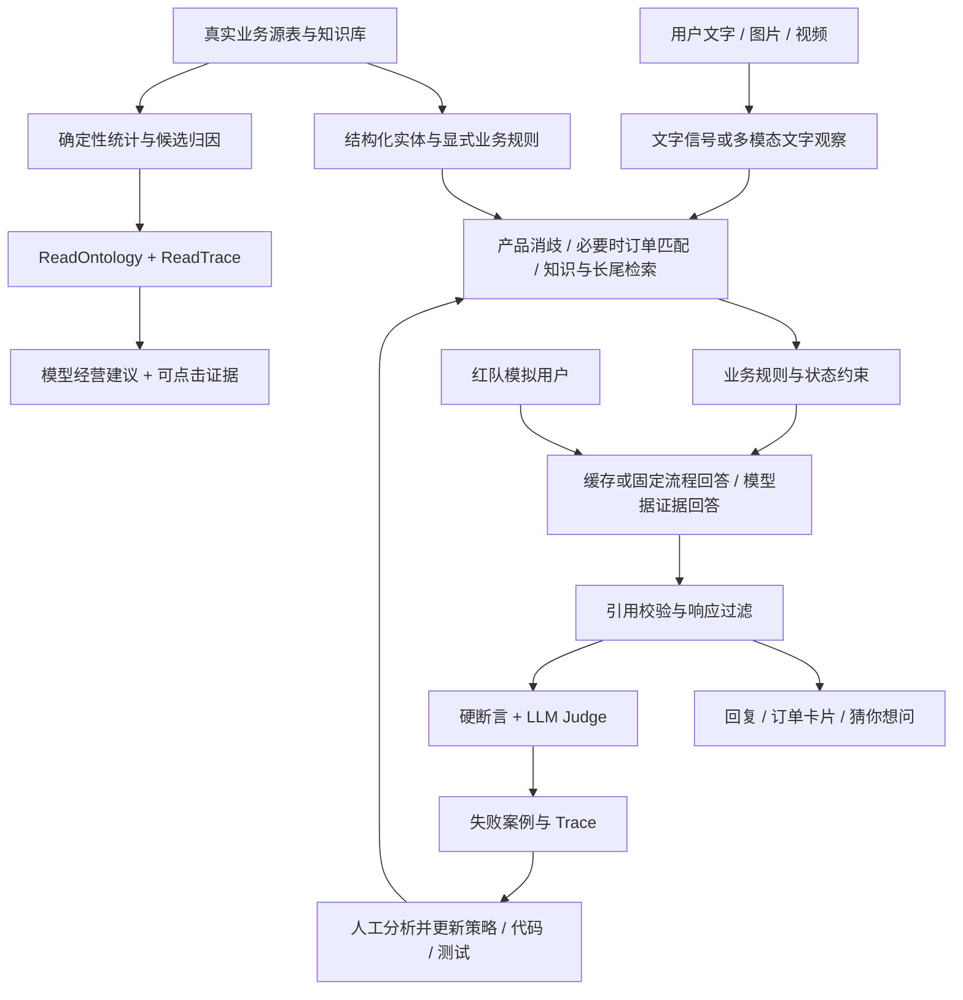

# OntoCare 架构与商业 BP 主张核验

核验日期：2026-10-17。依据当前源码与保存的历史评测文件；本次没有重新发起在线模型评测，也没有做商业收益实验。

## 1. 实际架构

```text
OntoCare-Data-Connected/
├── app.py                         服务入口、会话状态、业务规则、模型调用
├── dataset.py / data/             五张业务源表及快照、FAQ 缓存
├── 用户服务链路
│   ├── customer_signals.py        语言、情绪与实体信号
│   ├── general_support.py         通用排障先回答，不强制订单
│   ├── proactive_orders.py        主动匹配候选订单、处理产品冲突
│   ├── order_cards.py             订单图文卡片
│   ├── media_understanding.py     图片/视频抽帧→文字观察→待核验事实
│   ├── qa_workflows.py            同产品知识检索与 FAQ 缓存
│   ├── conversation_workflow.py   排障进度与多轮状态
│   ├── long_tail_knowledge.py     检索长尾处理策略
│   ├── grounded_response.py       依据来源生成回答、校验引用
│   ├── action_gateway.py          响应中的地址隐藏
│   └── followup_questions.py / quick_replies.py  本轮推荐问题
├── 商家服务链路
│   ├── mail_workflow.py / mail_editing.py        邮件草稿与改写
│   ├── handoffs.py                本地待审核交接
│   ├── analytics_assistant.py     读取实体、规则与记录→模型建议
│   └── tools/merchant_attribution/  构建全量归因快照及页面
├── ontology_catalog.py            本体字段定义
├── agents/                       客服/经营提示词与职责规范
├── knowledge/long_tail/           双语知识、长尾策略、多模态候选包
├── static/                       用户端、商家端、经营归因、评测页面
│   └── merchant-attribution-agent.js  统计、候选规则、行动摘要
├── benchmark/
│   ├── agents/red_team.py         Persona 与动态追问
│   ├── agents/blue_team.py        调用实际客服接口
│   ├── agents/judge.py            硬断言 + 可选 LLM Judge
│   ├── config/prompts.py          版本化评测提示词
│   ├── orchestrator/              调度、逐轮记录、故障注入
│   └── api.py / main.py           评测运行入口
├── evaluation/                   金标准及源表快照
├── reports/                      归因报告、修复复测、实测证据
├── tests/                        自动化回归测试
└── scripts/package_release.py       精简交付，排除密钥与运行数据
```

上述“用户服务链路”“商家服务链路”为阅读分组，不是实际目录。旧 attribution.py、analytics_api.py 为兼容入口。



本图是实现概念图；不是新增服务部署图。本体采用 Python/JSON 结构、字段关联和显式规则；没有核验到 RDF/SPARQL 图数据库推理。Trace 展示工具结果、规则和证据，不是模型隐藏思维过程。

## 2. 三个创新主张是否成立

| 主张 | 判定 | 可写进 BP 的版本 | 不应直接宣称 |
|---|---|---|---|
| 经营问题归因、增强业务复盘 | 已有功能支撑，业务收益待验证 | 将售后工单关联到产品、问题、规则和核查行动；建议可回溯源表原文 | 已找到真正根因、已降低故障率、已提高利润 |
| 本体低时延、低成本 | 有减少重复检索/模型调用的设计，缺少对照实测 | 常见问题通过缓存与固定流程处理，结构化关联减少人工翻找；复杂建议调用模型 | 本体一定比日志快、成本下降多少、在线毫秒级响应 |
| Bad Case 自进化 | 人工参与的持续改进闭环成立 | 评测发现问题→定位 Trace→人工更新策略/知识/代码→回归验证 | 无人审核自主学习、自主修改政策、模型已微调 |
| 红蓝对抗 + LLM Judge | 已实现，小规模在线运行已留证 | 对真实业务场景进行多轮追问，并联合检查业务边界、证据与语气 | 已证明全场景稳健、Judge 评分就是客观准确率 |

关键边界：地址过滤不等于完整 PII 防护；本地转人工记录不等于已接通企业 CRM；模型建议不等于已执行业务动作。当前视频为抽帧视觉理解，没有音频理解。长尾包导入是检索策略扩充，不是训练模型参数。所谓 KV Cache 实际是应用层问答缓存，不是模型内部 KV 张量缓存。

## 3. “80%”到底是什么

| 记录 | 实测口径 | 结果 | 正确解读 |
|---|---|---|---|
| benchmark/benchmark-metrics.json | 历史在线核心硬断言 | 62/74 = 83.8% | 最接近口述“80%”；只覆盖所列断言 |
| 同文件 | 历史硬断言与语义裁判联合通过 | 69/101 = 68.3% | 与核心样本分母不同，不能混算 |
| 同文件 | 历史受支持语义陈述 | 302/351 = 86.0% | 模型裁判估计，没有人工校准 |
| 同文件 | 含不受支持陈述的轨迹 | 41/101 = 40.6% | 暴露语义质量问题，不应只报高分；不是人工确认幻觉率 |
| reports/评测修复复测.json | 后续单次硬断言复测 | 在线、离线各 109/110；核心各 73/74 = 98.6% | 非最新全量语义成绩；没有新 pass³/pass⁸ |
| reports/红蓝对抗在线实测.json | U093 在线动态红队 + Judge | 1 个案例、2 轮，通过 | 证明链路能运行，不能证明总体效果 |

复测仍保留 U060 失败：该路径绕过模型，超时注入未触发。另设 U060-R1 验证，不能覆盖掉原失败记录。以上报告是保存的历史版本，后续新增功能尚不能沿用其成绩当成当前全量成绩。

历史在线完整响应 P50 约 2.63 秒、P95 约 9.00 秒，不含浏览器渲染，也不是首字时延。离线毫秒数排除了真实模型调用，不能用作线上 SLA。业务约束页的 $0.008、34% 等为 Mock，不是商业验证。

## 4. 建议的 BP 核心定位

**OntoCare 是面向售后团队的可追溯服务与经营复盘助手：用产品实体、业务规则和证据引用连接客户问题、处理建议与经营核查，并用对抗评测持续检验这些边界。**

三个客户痛点：
1. 多产品、多渠道、政策分散，客服容易反复追问或串用产品知识。
2. 工单堆积在邮件与日志中，运营难以快速核实高频问题和安排核查责任。
3. 修复一次坏案例后，缺少固定回归与证据记录，同类问题容易再次出现。

对应价值假设：少一次无效追问、少一次人工翻查、每次修复有回归依据。先用试点量化，再讲节省比例。

## 5. 六页路演 BP

1. **问题与真实案例**：展示原先“用户已说产品仍被追问型号/订单”的案例，说明体验损失与知识分散。样本为 63 条工单，不能代表全部市场。
2. **产品闭环**：客户服务→商家复盘→证据核查→评测改进；演示订单卡片、通用排障和经营助手。
3. **技术差异**：结构化实体与规则约束 + 模型理解/表达 + 可追溯证据。明确模型负责什么、确定性代码负责什么。不是声称发明本体论。
4. **验证结果**：分开列历史基线、修复复测与动态红蓝实测，写样本、版本、分母、是否用了 Judge；保留失败项和未测指标。
5. **商业落地**：首批使用者为客服主管、知识运营、产品质量团队；从单产品线只读辅助试点开始，接入真实权限与工单系统后扩大。可探索按席位或服务量收费，当前没有验证定价与付费意愿。
6. **边界与路线图**：时间字段、销量分母、身份权限、语义质量、视频音频能力、运营监控；说明下一步怎样验证，而非把规划写成已实现。

## 6. 下一轮补证实验

- 固定同一批工单、同一模型、相同知识库与机器，比较普通日志/文档检索方案和 OntoCare。预先定义正确性、证据定位时间、人工复核时间、模型调用数与费用。
- 分开测缓存命中、缓存未命中、经营助手三条路径；记录 TTFT 与完整响应 P50/P95，不能混用。
- 费用用实际 token usage 与实际结算单价计算；开发维护成本单独记录。
- 红蓝队扩展至全部 Persona、不同语言与风险场景，重复 3/8 次后才报告对应稳定性指标。
- 用人工盲评校准 LLM Judge；比较业务动作是否合法、证据是否充分、问题是否解决。当前判断含特定地址字符串等样本断言，不能代替全面泄露检测。
- 自进化实验：保留未参与修复的测试集，对比更新前后新案例通过率和老案例回退率；防止只记住已知坏案例。

## 7. 推荐答辩表述

“我们的创新是把售后处理、经营复盘和评测改进连起来。模型负责理解与表达，产品实体和业务规则帮助限定证据与动作范围。经营助手能从统计下钻到原始工单，并给出待核查建议。我们已经实现红蓝对抗与模型裁判，但目前成绩来自有限样本；低成本、低时延和实际经营收益还需要同条件对照试点验证。”

不要说“本体论让我们准确率 80%，已经降本 34%”。这些数字既不是同一指标，也没有相应因果或商业证明。
