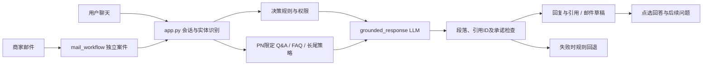

# OntoCare 架构审查与竞品改进建议

审查日期：2026-10-16。对象：OntoCare-数据接入版.zip 与对应工作目录。产品网页为公开能力说明，不代表已验证其内部实现或效果；不采用厂商宣传的准确率作为本项目基准。

## 结论

现有项目是 Flask 单体应用，Python 函数负责规则与检索，LLM 负责有依据的回复；不是5个自主Agent并行协作，也不是可脱离后端运行的单HTML。保留这个规模是合理的。当前最需要改进的是：实体识别可靠度、句子与证据的对应、规则和生成的边界、知识发布与回归验证。

## 核心目录与职责

```text
OntoCare-Data-Connected/
├─ app.py                      API入口、会话、实体解析、决策与编排
├─ dataset.py                  订单/工单等源数据加载
├─ ontology_catalog.py         本体输入包检查
├─ qa_workflows.py             原始Q&A、型号约束、常见问题缓存、安全词
├─ conversation_workflow.py    连续排障状态与已尝试步骤
├─ long_tail_knowledge.py      长尾词组匹配与策略引用
├─ grounded_response.py       实际运行的LLM Prompt及输出检查
├─ mail_workflow.py            邮件案件隔离、规则核对、带引用草稿
├─ handoffs.py                 本地人工/邮件交接记录
├─ followup_questions.py       根据本轮关联更新推荐问题
├─ quick_replies.py            当前追问的点选回答
├─ static/
│  ├─ index.html               用户端
│  ├─ merchant.html            商家端
│  ├─ anker.css                黑白界面样式
│  └─ merchant_assist.js       本次新增：语气、情绪提示、承诺检查
├─ data/                       源表快照、Q&A、FAQ缓存、邮件工单
├─ knowledge/long_tail/        已整理策略、导入审计、隔离原文
├─ agents/{router,responder,citations,workflow,mail}/Agent.md
│                              职责文档，不能仅靠改文件让运行时生效
├─ tools/                      源表导入与FAQ整理
├─ scripts/                    长尾导入、10题模型实测
├─ tests/                      Python回归测试
├─ reports/                    实测与本次审查报告
└─ run.sh / requirements.txt   启动与依赖
```

全部文件见《源码包实际目录树.md》。本次新增的辅助脚本和报告会在更新ZIP中出现。



## 国内外产品中可借鉴的做法

|来源|公开证据|适合本项目的改进|
|---|---|---|
|阿里 AliMe-KBQA|电商知识结构扩展到属性层级、键值、复合值，结合约束识别与推理；论文描述了促销场景部署|订单号精确查表；SKU先映射PN、地区与配件关系，再检索，不用名称相似度决定适用性。[原论文](https://arxiv.org/abs/1912.05728)|
|阿里云对话能力|支持澄清知识候选与按槽位反问|缺哪个关键字段就问哪个，同时显示2–4个真实候选按钮。不是反复要求用户重新描述。[澄清配置](https://help.aliyun.com/zh/document_detail/420739.html)、[槽位节点](https://help.aliyun.com/zh/outboundbot/slot-filling-nodes)|
|支付宝服务大厅|提供问题选择入口与在线客服入口|借鉴任务入口和点选体验；本次公开资料不足以证明支付宝当前内部反幻觉架构，不推断其内部模型或规则。[官方页面](https://help.alipay.com/hall/index.htm)|
|Intercom Fin|官方说明包括基于支持资料回答、歧义澄清、找不到答案时说明并转人工|增加“没认准产品”的明确状态；不要让生成模型替代码认定型号。其官方也承认仍可能回答错误。[说明](https://www.intercom.com/help/en/articles/7837535-fin-ai-agent-faqs)|
|Intercom Guidance|区分沟通风格、澄清、内容来源；检查指令歧义、重复、冲突与系统能力限制|将话术规范、检索范围、业务权限拆开管理，Prompt不写不存在的能力。[文档](https://www.intercom.com/help/en/articles/10210126-provide-fin-ai-agent-with-specific-guidance)|
|Gorgias|商品目录独立管理，知识按店铺区分；指导规则与商品事实分离；建议处理知识冲突、先测试后发布|多SKU时用结构化目录隔离型号和变体；长期库增加版本、适用范围、审核状态及冲突检查。[知识管理](https://docs.gorgias.com/en-US/knowledge-explained-6556817)、[商品信息来源](https://docs.gorgias.com/en-US/how-shopping-assistant-recommends-products-4996877)|

这些是可借鉴的设计，不是“竞品已彻底解决幻觉”的证明。淘宝相关结论以阿里公开论文为依据，不把历史论文说成今天淘宝客服的完整实现。

## 源码中的具体改进点

|优先级|目前证据与风险|建议落点|验收|
|---|---|---|---|
|P0|`grounded_response.generate`校验引用ID存在，但没有逐句验证引用是否支持结论|增加 claim_evidence：每个订单状态/金额/日期/政策结论绑定字段或原文片段；数字与订单字段确定性比较|正确引用ID+错误金额仍必须被拒绝；反例至少20组|
|P0|`resolve_product`结合关键词与订单SKU；名称S1 Pro跨品类重名|独立实体候选结构：PN、SKU、名称、证据来源、确认状态；歧义时点选扫地机/吸奶器|只说S1 Pro不能进入专属维修；明确T8D04不混入T2080|
|P0|grounded模式会在已有规则答复后调用LLM，FAQ命中不等于一定0调用|明确可缓存的审核完成回答分支，动态订单和安全内容不共用通用缓存；缓存key含PN、语言、知识版本|启用真实模型配置时，审核FAQ命中仍0模型调用；版本变更失效|
|P0|邮件原先使用较窄安全词，中文“熔化”可能漏判|本次统一使用qa_workflows.RISK；安全邮件不推断客户已受伤|熔化、烧焦味、出血进入安全核查，不继续普通充电建议|
|P1|`long_tail_knowledge.retrieve`是词组包含与长度排名，不是语义理解|先按PN/渠道/国家过滤，再做词法+向量检索，低分或候选接近时澄清|同义改写、否定、多个诉求、换型号、共享错误码等测试；别仅测原句|
|P1|长尾补充材料含待核验内容；来源存在不等于已证实|增加draft/reviewed/published、有效期、官方来源、适用PN、地区；只有published产品操作可直接建议|未审核材料仅用来追问/转人工，不给确定参数|
|P1|SESSIONS是进程内存；重启会丢对话；演示API缺少正式身份核验|部署前增加持久化、商家登录、会话归属校验、角色授权和日志脱敏|跨会话不能读他人订单；重启后可恢复；密钥不进HTML|
|P1|现有“流式”发送进度，最终回复一次返回|保持真实步骤进度；若加token流，未经校验内容不可直接承诺业务事实|断流有恢复/重试；不会把未审核内容标为最终答案|
|P1|8轮阈值是体验兜底，不能覆盖安全、连续失败、用户明确要人工|允许提前交接，携带已确认信息、失败步骤、引用、待补项|人工不用让客户重述；真实接通前只写“已保存请求”|
|P2|app.py集中入口、检索、规则、生成，修改相互影响|先拆实体解析与引用验证两处，不急于拆成多个Agent服务|接口与回归保持不变；没有新增无必要模型调用|

“KV Cache”需正名：当前FAQ答案缓存属于业务答案缓存；不是Transformer推理时的KV状态缓存。可在路演中解释为“审核后的高频工作流直接回答，长尾才调用模型”。是否真正0调用必须在当前grounded配置下测量。

## 15项邮件建议逐项处理

|功能|本次状态|处理方式或下一步|
|---|---|---|
|F01语气|部分实现|4种开场风格+恢复原文，业务正文保持不变；尚未做整封语义重写，不能宣称完成全部验收|
|F02情绪|有依据的简化实现|当前邮件关键词分数、SVG点及提示。仅首封邮件无多轮历史，因此不造曲线；未来按实际message_id/time生成趋势|
|F03多版本|建议下一批|共享事实对象和引用，三种表述；每版独立编辑。证据不足时不凑字数，不生成“后续承诺”|
|F04画像|待身份数据|订单号不是客户ID；不能把同订单工单数当个人历史，也不能从SKU推断购买渠道|
|F05置信度|不按原公式实施|最高40+30=70，达不到85阈值；改为“证据完整度”，列出缺项，不写“建议直接发送”|
|F06补课|待回流数据|统计真实未解决问题，生成待审FAQ；审核通过再发布，不能用mock频率冒充统计|
|F07附件|待真实附件与识别验证|非空链接只代表附件存在；识别结果是候选，不覆盖型号真值；缺附件显示未提供|
|F08跨渠道|已有聊天转邮件，反向待补|以授权后的案件ID继承，不按Anker001假定客户身份；保留来源和失效时间|
|F09补偿|不采用示例金额|25%折扣、20美元券、过保全额退都缺政策依据；仅提供人工审核入口，实际政策需授权且版本化|
|F10多语言|现有中英；其他待做|翻译保留PN/SKU/订单号/数字/否定词/引用；德法荷用母语人工抽检，不把语言风格刻板化|
|F11承诺检查|已实现保守前端检查|复制与模拟发送前提示；可应用保守建议并恢复；不插入原配置里无依据的3–5工作日。当前不是正式发信网关|
|F12摘要|待补|按已提供事实、客户陈述、缺失字段三栏；不虚构联系次数和历史|
|F13安抚|已有Prompt基础，建议强化|引用真实场景即可，例如“理解您明天要用”；不能接“我们会优先处理”除非有执行依据|
|F14时区|不按国家映射承诺|US/EU不是单一时区；需明确IANA时区+真实SLA截止时间，转换同一时间点，不能改成2小时承诺|
|F15段落改写|待补|捕获选区和草稿版本；改写后校验保护字段；处理期间编辑则放弃过期结果|

配置中的“单HTML不调用API”与当前真实LLM系统不同，本次保留Flask后端，不回退成假模拟。没有宣称15项全部实现。

## 值得增加的Prompt或Markdown

不要堆叠更多不被代码读取的Skill。当前Agent.md主要是维护规范；实际Prompt在grounded_response.py。

1. `prompts/entity_clarification.md`（建议）：输入候选PN及证据，只能返回给定candidate_id或ask_user，禁止创造型号。
2. `prompts/mail_rewrite.md`（建议）：输入事实对象、当前草稿、风格，只改变表达；输出修改前后字段比较与原引用ID。
3. `knowledge/policy_registry.md`（建议）：国家、渠道、生效起止、政策原文链接、审批人；缺值不能由LLM补齐。
4. `docs/prompts/agents/citations/Agent.md`（已补充验收建议）：引用存在与结论被支持是两种不同检查。
5. `docs/prompts/agents/mail/Agent.md`（已更新实际行为）：统一安全识别、语气保护、模拟发送检查、不生成虚构情绪历史。
6. 建议新增评测集：同名产品、SKU后缀、否定句、拆单部分签收、重复排障、政策冲突、无身份资料、邮件提示注入、用户手改承诺、多语言日期。

## 可以增加的小巧思

- “我已经试过”：把已尝试步骤变成可勾选记录，后续自动跳过，而不是只改语气。
- 选择订单里的“主机/配件包”：展示真实SKU和包裹状态，别让客户抄长串单号。
- 商家看到“这句话依据哪条资料”：点一句话展开对应字段或原文，避免底部一串引用看不出对应关系。
- “这不是我的产品”：一键撤销错误型号，同时清除关联排障上下文。
- “仍未解决”：累计相同建议出现次数，第二次失败就提出人工处理，不机械等8轮。
- “回答哪里不对”：选择型号错/答非所问/步骤无效/政策不清，进入待审知识改进队列，不直接污染已发布库。

## 本次验证与限制

86项Python测试通过；Node辅助逻辑测试通过，验证语气变更保留业务正文、承诺词识别与保守替换、情绪关键词差异。浏览器可读取新增控件，但预览窗口宽度为0，无法完成截图及完整点击验证，移动端未验收。本次没有把前端检查当成服务器端安全网关；未调用真实邮件发送。F01只改变开场，F02不造历史，F11仅有限模式检查，均不宣称完整15项验收通过。
