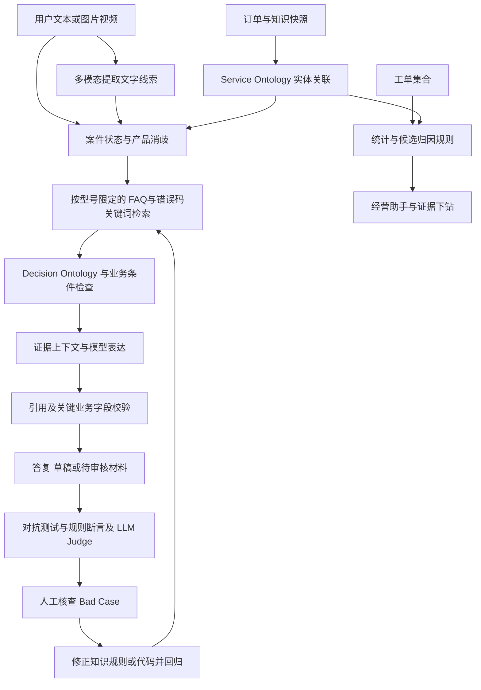

# Anker · OntoCare

**基于双本体与评测改进闭环的经营归因智能客服系统**

面向复杂售后，将一次零散求助串成产品消歧、证据检索、排障引导与人工审核的服务链路；再将工单集合转化为带源表行号和规则 ID 的经营核查建议。

[项目介绍 · 在线阅读](https://jiangenjing.github.io/anker-OntoCare/) · [现场演讲原文](docs/路演演讲稿-现场原文.md) · [演讲稿HTML](https://jiangenjing.github.io/anker-OntoCare/docs/%E8%B7%AF%E6%BC%94%E6%BC%94%E8%AE%B2%E7%A8%BF-%E7%8E%B0%E5%9C%BA%E5%8E%9F%E6%96%87.html) · [技术架构](#技术架构) · [快速开始](#快速开始) · [评测结果](#评测结果与口径) · [文档目录](OntoCare/docs/README.md)

> 本仓库是黑客松项目的可运行代码与材料归档。GitHub Pages 展示静态介绍；客服、邮件生成与经营助手需要 Python 后端和相应模型配置。现场演讲稿保留历史原文，当前实现与数据口径以本 README、源码和原始评测记录为准。

## 先看核心技术架构

**这是本项目的核心材料，建议先打开原图查看节点、连线与服务闭环。**


[放大架构原图](OntoCare/docs/assets/ontocare-technical-architecture.png) · **[打开图文交互介绍](https://jiangenjing.github.io/anker-OntoCare/docs/%E5%8F%82%E8%B5%9B%E6%8F%90%E4%BA%A4%E8%AF%B4%E6%98%8E-%E6%96%B0%E5%A2%9E%E8%A1%A5%E5%85%85%E7%89%88%E6%9C%AC.html#architecture)**

图中包含路演方案设计，当前实现以以下正文与源码为准。

## 项目背景

真实售后求助往往包含信息缺失、名称歧义、故障图片、情绪表达，以及不同渠道的服务规则。只召回一段 FAQ，无法覆盖后续判断与交接。

| 场景难点 | OntoCare 的处理方式 |
|---|---|
| “S1 Pro 不吸了”既可能指扫地机，也可能指吸奶器 | 结合品类、型号、订单 SKU 和会话上下文消歧，限定检索范围 |
| 用户只有故障照片或视频，难以描述现象 | 提取可见线索与不确定项，转为文字证据后检索 |
| 用户记不住订单号，或有多个订单 | 主动匹配资料快照，提供带图片、订单号和日期的候选卡片 |
| 多轮对话重复追问、丢失排障进度 | 保留当前案件信息、已尝试步骤与反馈，更新“猜你想问” |
| 售后政策复杂，模型容易越界承诺 | 通过显式规则、证据检查与输出约束限制业务判断 |
| 工单处理结束后，经验难以复用 | 聚合工单、绑定候选归因规则和源表行号，形成可核查建议 |

订单卡片使用提供的演示资料，产品匹配不代表已验证订单归属。常规产品排障可以先回答；涉及物流、保修资格等个案事实时再核验必要信息。

## 功能展示

### 用户端：让求助更容易表达，让回答有据可查

- **多模态输入**：支持图片，以及视频采样画面的可见事实提取；文字证据进入既有检索流程。
- **产品消歧与候选订单**：按产品和上下文关联资料，提供点击选择的订单卡片。
- **连续排障**：记忆已尝试步骤，避免反复从头询问。
- **引用与 Trace**：答复附来源，处理步骤可展示本体引用并折叠查看。
- **动态追问与语言跟随**：根据当前案件和本体关联更新建议问题；中文表述中的英文产品名不触发英文回复。
- **人工审核材料**：信息不足或高风险诉求时保留不确定性，整理上下文供后续审核。

<details>
<summary>查看用户端截图</summary>


</details>

### 商家端：从客户来信到经营核查

- **邮件辅助处理**：结合客户原文、产品、订单、物流和知识生成可编辑草稿，支持改写与多语言处理。
- **经营可视化看板**：展示工单产品分布、咨询场景、错误码及候选归因，支持查看源表行号和原始邮件。
- **经营归因助手**：调用 `ReadOntology`、`ReadTrace` 读取实体、规则和工单证据，给出自然语言建议与可展开的证据链。

<details>
<summary>查看经营归因截图</summary>


</details>

### 评测工作台：从结果下钻到失败原因

提供历史实测结果、红蓝对抗原理、业务约束演示与案例 Trace。真实记录和模拟业务目标分开展示；模拟数据不作为实测降本或生产达标证据。

## 三个核心设计

### 1. 双本体：组织业务证据，显式表达决策边界

**Service Ontology** 关联产品、订单、知识和证据，帮助确定“当前在处理哪个对象、哪些资料适用”；**Decision Ontology** 将案件条件与允许／禁止动作关联，降低跨型号知识混用和超政策承诺风险。

当前实现采用 JSON 数据、实体关联和 Python 规则。它不是 RDF/SPARQL 图数据库系统，部分业务变更仍需要修改代码并回归验证。模型负责理解与表达，业务条件由显式逻辑计算。

相关源码：[本体目录](OntoCare/ontology_catalog.py) · [业务路由与规则](OntoCare/app.py) · [知识工作流](OntoCare/qa_workflows.py) · [输出投影](OntoCare/action_gateway.py)

### 2. Bad Case 驱动的改进闭环：发现、核查、修正、回归

项目将“自进化”落实为有人工审核参与的工程改进流程：

1. **Persona 对抗**：模拟不同诉求和沟通风格，进行多轮交互并保存轨迹。
2. **联合评测**：硬性断言检查关键字段和边界，LLM-as-Judge 补充语义质量判断。
3. **定位与修正**：分析错误来自产品绑定、知识召回、回复表达还是规则缺失，修正对应知识、策略或代码。
4. **审核与复测**：经人工核查后更新，并通过回归记录检查效果。

用户反馈可作为排查线索；点赞／点踩不等于正确标签，不应未经审核直接成为知识。当前没有独立 Supervisor Agent、自动向量权重更新或模型参数训练。演讲中提及的这些机制保留为历史方案表述，不作为已实现能力。

相关源码：[评测编排](OntoCare/benchmark/orchestrator/runner.py) · [长尾策略检索](OntoCare/long_tail_knowledge.py) · [评测原始数据](OntoCare/benchmark/)

### 3. 经营归因：从单个工单延伸到工单集合

基于 **63条脱敏工单快照**，程序计算统计，规则标记候选，模型结合限定证据组织建议。每条分析可下钻至工单原文、Excel 行号与对应规则。

| 候选规则 | 含义 |
|---|---|
| RC1 | 上下文丢失候选，辅助核查信息是否衔接完整 |
| RC2 | 规则散落候选，辅助核查服务知识与业务规则覆盖 |
| RC3 | 产品设计核查候选，需要进一步复现与排除其他原因 |
| RC4 | 过保临界窗口候选，需要完整日期和 SKU 关联条件 |

例如，快照中 E25、E28 两条工单含有 `3212` 错误码及相似描述，可建议按型号核查维护与复现条件。候选关联不等于已经确认设计缺陷，也不能在缺少时间和销量分母时推断“故障爆发”或故障率。

相关源码：[统计与候选归因](OntoCare/attribution.py) · [经营助手](OntoCare/analytics_assistant.py) · [归因结果快照](OntoCare/reports/attribution_report.json)

## 技术架构

[查看核心架构原图](OntoCare/docs/assets/ontocare-technical-architecture.png) · [打开可交互图解版](https://jiangenjing.github.io/anker-OntoCare/docs/%E5%8F%82%E8%B5%9B%E6%8F%90%E4%BA%A4%E8%AF%B4%E6%98%8E-%E6%96%B0%E5%A2%9E%E8%A1%A5%E5%85%85%E7%89%88%E6%9C%AC.html#architecture)

上图为项目路演架构材料；当前代码的运行职责可按以下链路阅读：



| 层次 | 当前职责 | 主要模块 |
|---|---|---|
| 前端交互 | 聊天、邮件、经营看板、评测页面 | `static/` |
| 服务与会话 | 路由、案件状态、规则计算 | `app.py`、`conversation_workflow.py` |
| 多模态证据 | 图片理解、视频采样、文字证据 | `media_understanding.py`、`ontocare_multimodal/` |
| 知识与策略 | 型号过滤、固定 FAQ、错误码和关键词匹配、长尾补充 | `qa_workflows.py`、`general_support.py`、`long_tail_knowledge.py` |
| 模型表达 | 基于限定证据组织客服答复与邮件 | `grounded_response.py`、`mail_workflow.py` |
| 归因分析 | 统计、规则匹配、证据链与建议 | `attribution.py`、`analytics_assistant.py` |
| 评测 | Persona、轨迹、断言与模型裁判 | `benchmark/`、`tests/` |

当前主链路未接入 ChromaDB、Redis 或 Embedding 向量召回。“图谱＋向量混合检索”是历史演讲中的方案方向；现有检索和缓存应以上表及源码为准。多个确定性检查用于降低错误风险，不意味着能够消除全部幻觉。

## 快速开始

### 环境要求

- Python 3.10+，以及首次安装依赖所需的网络。
- 接入真实模型时，需可用的兼容接口、模型名称与自己的 API Key。
- 视频处理需要系统安装 `ffmpeg`；当前是采样画面理解，不包含音轨转写或完整视频语义理解。
- Node.js 用于部分看板构建和测试；普通页面访问不需要运行前端构建服务。

### 下载并启动

macOS / Linux：

```sh
git clone https://github.com/jiangenjing/anker-OntoCare.git
cd anker-OntoCare/OntoCare
cp .env.example .env.local
# 在本机编辑 .env.local，填写自己的模型配置
bash run.sh
```

`run.sh` 首次创建 `.venv` 并安装 `requirements.txt`，随后加载 `.env.local`。不要将真实密钥提交到仓库。也可以按 `demo_api_config.example.json` 建立本机 `demo_api_config.json`；该文件优先于部分环境变量配置，公开仓库不包含它。

未配置模型时，部分固定 FAQ 和规则流程仍可使用；这不等于模型已成功接入。图片理解、开放式生成等能力依赖相应服务。

### 本地页面

| 页面 | 地址 |
|---|---|
| 用户端 | http://127.0.0.1:5088/ |
| 商家邮件 | http://127.0.0.1:5088/merchant |
| 经营归因 | http://127.0.0.1:5088/analytics |
| 评测工作台 | http://127.0.0.1:5088/benchmark.html#view=results |

可先问“我的 S1 Pro 不吸了”观察消歧，或“我的715充电器无法为手机充电”检查通用排障；经营助手可以问“X10 Pro 的工单有哪些特征？”，再点击证据节点核对来源。

公网部署可使用 `bash run-online.sh` 或容器配置；参见 [公网部署说明](OntoCare/docs/deployment/public-demo.md)。公网评委入口使用 `judge_server.py`，其中关闭了评测运行等维护接口。GitHub Pages 本身不运行这些后端能力。

## 评测结果与口径

基础资料包含63条工单、16个唯一订单号、24条订单明细、593条扫地机问答、282条吸奶器问答和336条经销商资料。不同评测轮次和指标分开列示：

| 结果 | 数据范围与说明 | 来源 |
|---|---|---|
| **83.8%（62/74）** | 历史在线核心任务首轮硬性断言通过率 | [历史结果](OntoCare/benchmark/benchmark-results.json) |
| **98.6%（73/74）** | 修复后核心任务单轮复测硬性断言通过率 | [修复复测](OntoCare/benchmark/repair-final-results.json) |
| **109/110** | 修复后完整任务集，在线、离线各单轮的通过数 | [修复复测](OntoCare/benchmark/repair-final-results.json) |
| **P50 2.63秒 / P95 9.00秒** | 历史746次非故障注入请求的完整回答时延；进程内测试加真实接口调用，不含浏览器 | [历史指标](OntoCare/benchmark/benchmark-metrics.json) |

以上是不同版本的历史记录与复测，不能合并解释为“8轮问题解决率从83%提高到98%”。`pass^k` 的重复运行硬断言统计也不等于 k 轮对话解决率。LLM Judge 结果属于模型判断，尚需人工校准。

没有经过同口径验证的“平均3秒”“单次几分钱”“生产成本压降”不作为本仓库结论。业务约束页的成本目标含演示数据；实际成本需记录所用模型、价格、Token与请求量后计算。

### 运行测试

在 `OntoCare/` 下：

```sh
.venv/bin/python -m unittest discover -s tests -q
```

2026-10-19 文件整理后，本机提交版241项测试有236项通过；公开版去除私有连接配置后有235项通过、6项未通过，其中5项为既有问题，另1项依赖已移除的预配置。没有将其标为全量通过；本次文档更新没有重新运行付费模型评测。

## 仓库结构

```text
anker-OntoCare/
├── README.md                     项目首页
├── index.html                    GitHub Pages阅读入口
├── docs/                         参赛介绍、HTML阅读页与现场演讲原文
├── presentation/                 路演HTML、PDF与可编辑PPT
└── OntoCare/
    ├── app.py                    本地应用入口与业务规则
    ├── judge_server.py           公网评委体验入口
    ├── *.py                      业务模块，保持既有导入兼容
    ├── docs/                     使用指南、Prompt、策略与验收文档
    ├── scripts/                  导入、构建与打包工具
    ├── tests/                    自动化测试
    ├── benchmark/                评测编排与结果
    ├── evaluation/               测试用例与来源快照
    ├── reports/                  结构化分析结果与截图
    ├── data/                     业务数据
    ├── knowledge/                结构化长尾知识
    ├── ontocare_multimodal/       多模态适配
    └── static/                   HTML、CSS、JavaScript与资源
```

## 材料与团队

| 材料 | 入口 |
|---|---|
| 项目介绍 | [在线HTML](https://jiangenjing.github.io/anker-OntoCare/) · [Markdown](docs/参赛提交说明-新增补充版本.md) |
| 当时的演讲稿（保留原文） | [现场原文](docs/路演演讲稿-现场原文.md) · [HTML阅读版](docs/路演演讲稿-现场原文.html) |
| 技术与模块说明 | [架构导读](OntoCare/docs/architecture/system-overview.md) · [模块索引](OntoCare/docs/architecture/module-index.md) |
| 使用、部署、Prompt与验收 | [文档导航](OntoCare/docs/README.md) |
| 路演文件 | [presentation/](presentation/) |

**OntoCare 本体队**：

| 成员 | 学校 | 分工 |
|---|---|---|
| 蒋恩晶 | 清华大学 | 整体方案架构、产品设计、路演答辩 |
| 叶品驿 | 浙江工业大学 | Agent 后端开发 |
| 雷景喻 | 南京大学 | Agent 评测、前端页面开发 |

## 当前边界与后续方向

- 真实退款、换货、赔付、邮件发送和外部工单执行系统尚需接入；当前主要形成建议、草稿与本地审核材料。
- 演示订单匹配不构成身份认证；生产环境还需要用户授权、权限隔离和数据生命周期管理。现有地址输出遮蔽不等于完整 PII 治理。
- 人工审核后的知识与规则改进已有工程实践；自动发布、自动向量降权和独立监督代理属于后续方向。
- 经营归因输出是核查线索，不能仅凭快照认定因果或估算利润收益。
- 部分历史材料图片使用飞书临时链接，失效后需维护者替换；架构图和截图使用仓库内资源。

欢迎通过 [Issues](https://github.com/jiangenjing/anker-OntoCare/issues) 反馈可复现问题。请附输入、预期行为和已脱敏的实际结果，不要提交 API Key 或真实客户隐私。原始赛题资料和第三方素材的再使用应遵循各自授权；公开仓库不自动赋予这些素材的再分发许可。
