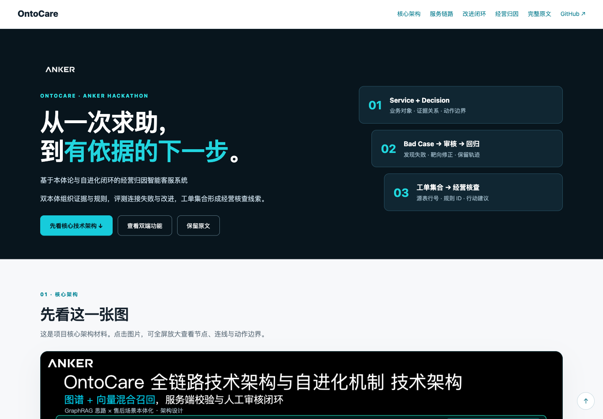
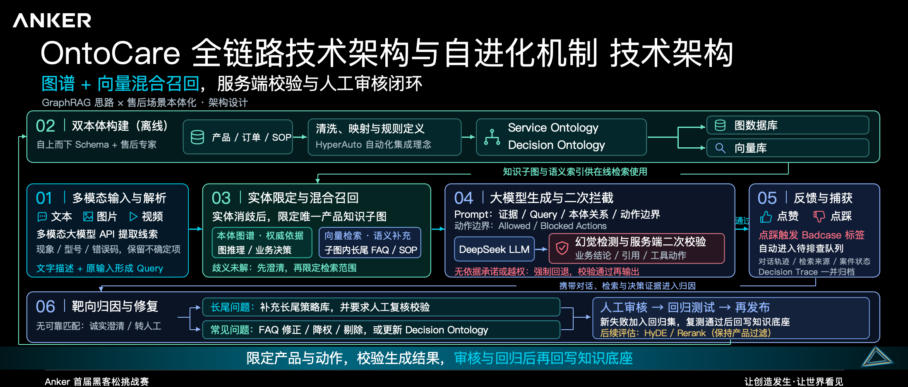
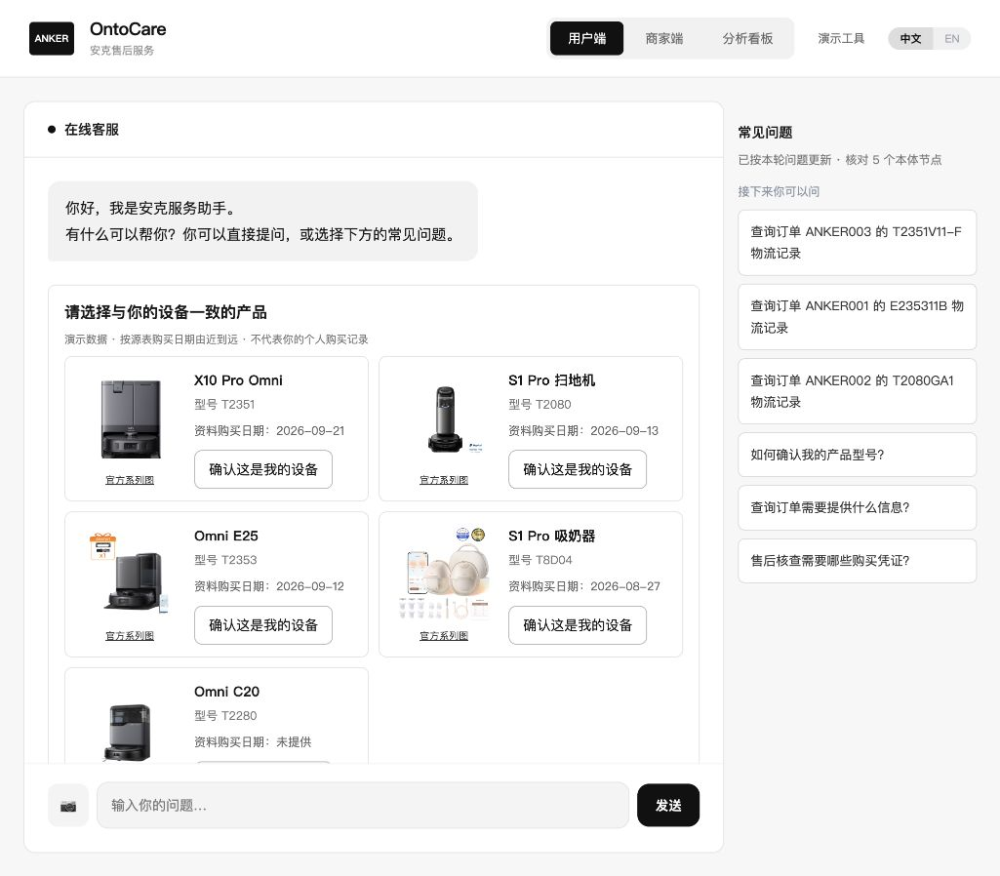
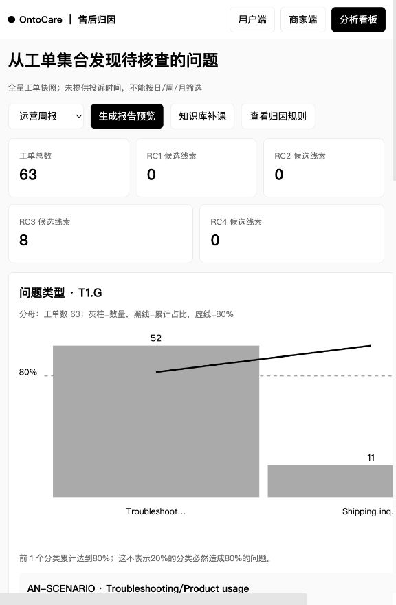
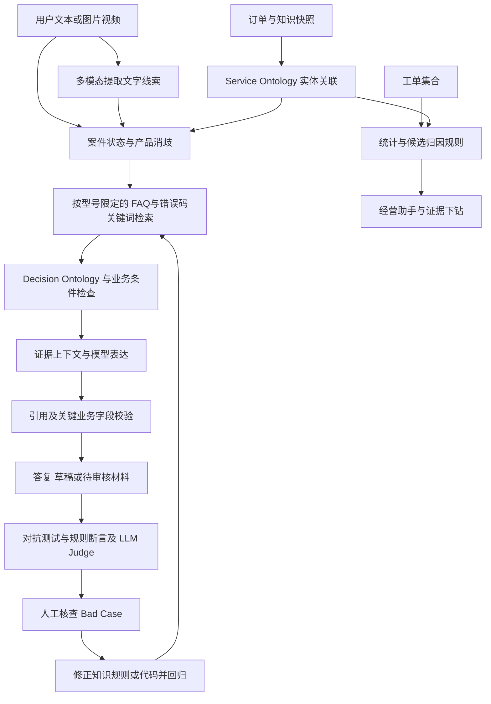
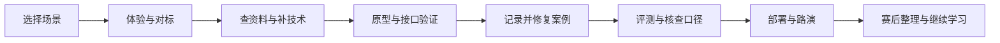

# Anker · OntoCare

## [点击打开：图文交互项目介绍 ↗](https://jiangenjing.github.io/anker-OntoCare/docs/%E5%8F%82%E8%B5%9B%E6%8F%90%E4%BA%A4%E8%AF%B4%E6%98%8E-%E6%96%B0%E5%A2%9E%E8%A1%A5%E5%85%85%E7%89%88%E6%9C%AC.html)

**建议先看这一页：技术架构、双端截图、六步服务流程、改进闭环和经营归因，图文结合展示。**

[](https://jiangenjing.github.io/anker-OntoCare/docs/%E5%8F%82%E8%B5%9B%E6%8F%90%E4%BA%A4%E8%AF%B4%E6%98%8E-%E6%96%B0%E5%A2%9E%E8%A1%A5%E5%85%85%E7%89%88%E6%9C%AC.html)

---

**基于双本体与评测改进闭环的经营归因智能客服系统**

面向复杂售后，将一次零散求助串成产品消歧、证据检索、排障引导与人工审核的服务链路；再将工单集合转化为带源表行号和规则 ID 的经营核查建议。

[联系与实习意向](#联系与实习意向) · [赛后复盘](docs/retrospective/赛后复盘-非CS科班黑客松经历.md) · [完整开发过程](#完整参赛开发过程) · [现场演讲原文](docs/路演演讲稿-现场原文.md) · [演讲稿HTML](https://jiangenjing.github.io/anker-OntoCare/docs/%E8%B7%AF%E6%BC%94%E6%BC%94%E8%AE%B2%E7%A8%BF-%E7%8E%B0%E5%9C%BA%E5%8E%9F%E6%96%87.html) · [技术架构](#技术架构) · [快速开始](#快速开始) · [评测结果](#评测结果与口径) · [文档目录](OntoCare/docs/README.md)

> 本仓库是黑客松项目的可运行代码与材料归档。GitHub Pages 展示静态介绍；客服、邮件生成与经营助手需要 Python 后端和相应模型配置。现场演讲稿保留历史原文，当前实现与数据口径以本 README、源码和原始评测记录为准。

## 先看核心技术架构

**这是本项目的核心材料，建议先打开原图查看节点、连线与服务闭环。**



[放大架构原图](OntoCare/docs/assets/ontocare-technical-architecture.png) · **[打开图文交互介绍](https://jiangenjing.github.io/anker-OntoCare/docs/%E5%8F%82%E8%B5%9B%E6%8F%90%E4%BA%A4%E8%AF%B4%E6%98%8E-%E6%96%B0%E5%A2%9E%E8%A1%A5%E5%85%85%E7%89%88%E6%9C%AC.html#architecture)**

图中包含路演方案设计，当前实现以以下正文与源码为准。

## 从哪里开始阅读

| 你的目的 | 建议路线 |
|---|---|
| 快速理解这个项目 | 核心架构图 → 双端功能 → 三个核心设计 → 评测结果 |
| 查看比赛过程与个人体会 | [赛后复盘原文](docs/retrospective/赛后复盘-非CS科班黑客松经历.md) → [当时的演讲稿](docs/路演演讲稿-现场原文.md) |
| 把代码在本机跑起来 | 快速开始 → 模型配置 → 本地页面 → 常见问题 |
| 审阅技术实现 | 技术架构 → 源码职责 → API入口 → 测试与原始记录 |
| 继续开发 | 关键Bad Case → 数据与知识维护 → 贡献方式与后续方向 |

目录：[项目背景](#项目背景) · [功能展示](#功能展示) · [三个核心设计](#三个核心设计) · [技术架构](#技术架构) · [快速开始](#快速开始) · [配置详解](#模型配置详解) · [评测结果](#评测结果与口径) · [开发过程与复盘](#开发过程与赛后复盘) · [常见问题](#常见问题) · [仓库结构](#仓库结构)

## 项目背景

真实售后求助往往包含信息缺失、名称歧义、故障图片、情绪表达，以及不同渠道的服务规则。只召回一段 FAQ，无法覆盖后续判断与交接。

| 场景难点 | OntoCare 的处理方式 |
|---|---|
| “S1 Pro 不吸了”既可能指扫地机，也可能指吸奶器 | 结合品类、型号、订单 SKU 和会话上下文消歧，限定检索范围 |
| 用户只有故障照片或视频，难以描述现象 | 提取可见线索与不确定项，转为文字证据后检索 |
| 用户记不住订单号，或有多个订单 | 主动匹配资料快照，提供带图片、订单号和日期的候选卡片 |
| 多轮对话重复追问、丢失排障进度 | 保留当前案件信息、已尝试步骤与反馈，更新“猜你想问” |
| 售后政策复杂，模型容易越界承诺 | 通过显式规则、证据检查与输出约束限制业务判断 |
| 工单处理结束后，经验难以复用 | 聚合工单、绑定候选归因规则和源表行号，形成可核查建议 |

订单卡片使用提供的演示资料，产品匹配不代表已验证订单归属。常规产品排障可以先回答；涉及物流、保修资格等个案事实时再核验必要信息。

## 功能展示

### 用户端：让求助更容易表达，让回答有据可查

- **多模态输入**：支持图片，以及视频采样画面的可见事实提取；文字证据进入既有检索流程。
- **产品消歧与候选订单**：按产品和上下文关联资料，提供点击选择的订单卡片。
- **连续排障**：记忆已尝试步骤，避免反复从头询问。
- **引用与 Trace**：答复附来源，处理步骤可展示本体引用并折叠查看。
- **动态追问与语言跟随**：根据当前案件和本体关联更新建议问题；中文表述中的英文产品名不触发英文回复。
- **人工审核材料**：信息不足或高风险诉求时保留不确定性，整理上下文供后续审核。

<details>
<summary>查看用户端截图</summary>



</details>

### 商家端：从客户来信到经营核查

- **邮件辅助处理**：结合客户原文、产品、订单、物流和知识生成可编辑草稿，支持改写与多语言处理。
- **经营可视化看板**：展示工单产品分布、咨询场景、错误码及候选归因，支持查看源表行号和原始邮件。
- **经营归因助手**：调用 `ReadOntology`、`ReadTrace` 读取实体、规则和工单证据，给出自然语言建议与可展开的证据链。

<details>
<summary>查看经营归因截图</summary>



</details>

### 评测工作台：从结果下钻到失败原因

提供历史实测结果、红蓝对抗原理、业务约束演示与案例 Trace。真实记录和模拟业务目标分开展示；模拟数据不作为实测降本或生产达标证据。

## 三个核心设计

### 1. 双本体：组织业务证据，显式表达决策边界

**Service Ontology** 关联产品、订单、知识和证据，帮助确定“当前在处理哪个对象、哪些资料适用”；**Decision Ontology** 将案件条件与允许／禁止动作关联，降低跨型号知识混用和超政策承诺风险。

当前实现采用 JSON 数据、实体关联和 Python 规则。它不是 RDF/SPARQL 图数据库系统，部分业务变更仍需要修改代码并回归验证。模型负责理解与表达，业务条件由显式逻辑计算。

相关源码：[本体目录](OntoCare/ontology_catalog.py) · [业务路由与规则](OntoCare/app.py) · [知识工作流](OntoCare/qa_workflows.py) · [输出投影](OntoCare/action_gateway.py)

### 2. Bad Case 驱动的改进闭环：发现、核查、修正、回归

项目将“自进化”落实为有人工审核参与的工程改进流程：

1. **Persona 对抗**：模拟不同诉求和沟通风格，进行多轮交互并保存轨迹。
2. **联合评测**：硬性断言检查关键字段和边界，LLM-as-Judge 补充语义质量判断。
3. **定位与修正**：分析错误来自产品绑定、知识召回、回复表达还是规则缺失，修正对应知识、策略或代码。
4. **审核与复测**：经人工核查后更新，并通过回归记录检查效果。

用户反馈可作为排查线索；点赞／点踩不等于正确标签，不应未经审核直接成为知识。当前没有独立 Supervisor Agent、自动向量权重更新或模型参数训练。演讲中提及的这些机制保留为历史方案表述，不作为已实现能力。

相关源码：[评测编排](OntoCare/benchmark/orchestrator/runner.py) · [长尾策略检索](OntoCare/long_tail_knowledge.py) · [评测原始数据](OntoCare/benchmark/)

### 3. 经营归因：从单个工单延伸到工单集合

基于 **63条脱敏工单快照**，程序计算统计，规则标记候选，模型结合限定证据组织建议。每条分析可下钻至工单原文、Excel 行号与对应规则。

| 候选规则 | 含义 |
|---|---|
| RC1 | 上下文丢失候选，辅助核查信息是否衔接完整 |
| RC2 | 规则散落候选，辅助核查服务知识与业务规则覆盖 |
| RC3 | 产品设计核查候选，需要进一步复现与排除其他原因 |
| RC4 | 过保临界窗口候选，需要完整日期和 SKU 关联条件 |

例如，快照中 E25、E28 两条工单含有 `3212` 错误码及相似描述，可建议按型号核查维护与复现条件。候选关联不等于已经确认设计缺陷，也不能在缺少时间和销量分母时推断“故障爆发”或故障率。

相关源码：[统计与候选归因](OntoCare/attribution.py) · [经营助手](OntoCare/analytics_assistant.py) · [归因结果快照](OntoCare/reports/attribution_report.json)

## 技术架构

[查看核心架构原图](OntoCare/docs/assets/ontocare-technical-architecture.png) · [打开可交互图解版](https://jiangenjing.github.io/anker-OntoCare/docs/%E5%8F%82%E8%B5%9B%E6%8F%90%E4%BA%A4%E8%AF%B4%E6%98%8E-%E6%96%B0%E5%A2%9E%E8%A1%A5%E5%85%85%E7%89%88%E6%9C%AC.html#architecture)

上图为项目路演架构材料；当前代码的运行职责可按以下链路阅读：



| 层次 | 当前职责 | 主要模块 |
|---|---|---|
| 前端交互 | 聊天、邮件、经营看板、评测页面 | `static/` |
| 服务与会话 | 路由、案件状态、规则计算 | `app.py`、`conversation_workflow.py` |
| 多模态证据 | 图片理解、视频采样、文字证据 | `media_understanding.py`、`ontocare_multimodal/` |
| 知识与策略 | 型号过滤、固定 FAQ、错误码和关键词匹配、长尾补充 | `qa_workflows.py`、`general_support.py`、`long_tail_knowledge.py` |
| 模型表达 | 基于限定证据组织客服答复与邮件 | `grounded_response.py`、`mail_workflow.py` |
| 归因分析 | 统计、规则匹配、证据链与建议 | `attribution.py`、`analytics_assistant.py` |
| 评测 | Persona、轨迹、断言与模型裁判 | `benchmark/`、`tests/` |

当前主链路未接入 ChromaDB、Redis 或 Embedding 向量召回。“图谱＋向量混合检索”是历史演讲中的方案方向；现有检索和缓存应以上表及源码为准。多个确定性检查用于降低错误风险，不意味着能够消除全部幻觉。

## 快速开始

### 环境要求

- Python 3.10+，以及首次安装依赖所需的网络。
- 接入真实模型时，需可用的兼容接口、模型名称与自己的 API Key。
- 视频处理需要系统安装 `ffmpeg`；当前是采样画面理解，不包含音轨转写或完整视频语义理解。
- Node.js 用于部分看板构建和测试；普通页面访问不需要运行前端构建服务。

### 下载并启动

macOS / Linux：

```sh
git clone https://github.com/jiangenjing/anker-OntoCare.git
cd anker-OntoCare/OntoCare
cp .env.example .env.local
# 在本机编辑 .env.local，填写自己的模型配置
bash run.sh
```

`run.sh` 首次创建 `.venv` 并安装 `requirements.txt`，随后加载 `.env.local`。不要将真实密钥提交到仓库。也可以按 `demo_api_config.example.json` 建立本机 `demo_api_config.json`；该文件优先于部分环境变量配置，公开仓库不包含它。

未配置模型时，部分固定 FAQ 和规则流程仍可使用；这不等于模型已成功接入。图片理解、开放式生成等能力依赖相应服务。

### 本地页面

| 页面 | 地址 |
|---|---|
| 用户端 | http://127.0.0.1:5088/ |
| 商家邮件 | http://127.0.0.1:5088/merchant |
| 经营归因 | http://127.0.0.1:5088/analytics |
| 评测工作台 | http://127.0.0.1:5088/benchmark.html#view=results |

可先问“我的 S1 Pro 不吸了”观察消歧，或“我的715充电器无法为手机充电”检查通用排障；经营助手可以问“X10 Pro 的工单有哪些特征？”，再点击证据节点核对来源。

公网部署可使用 `bash run-online.sh` 或容器配置；参见 [公网部署说明](OntoCare/docs/deployment/public-demo.md)。公网评委入口使用 `judge_server.py`，其中关闭了评测运行等维护接口。GitHub Pages 本身不运行这些后端能力。

## 模型配置详解

### 方式一：服务端环境变量

`run.sh` 会读取 `OntoCare/.env.local`。以下是字段示例，地址和模型名都需要替换为你实际拥有的服务：

```dotenv
LLM_BASE_URL=https://api.example.com/v1
LLM_MODEL=your-text-model
LLM_API_KEY=your_api_key
LLM_RESPONSE_MODE=grounded
VISION_BASE_URL=https://api.example.com/v1
VISION_MODEL=your-vision-model
VISION_API_KEY=your_vision_api_key
```

| 配置项 | 用途 | 注意事项 |
|---|---|---|
| `LLM_BASE_URL` | 文字模型的兼容接口根地址 | 代码会追加 `/chat/completions`，不要重复填写完整路径 |
| `LLM_MODEL` | 文字模型名称或服务商部署ID | 以你的服务商实际可用模型为准 |
| `LLM_API_KEY` | 文字模型访问凭证 | 只在本机或部署平台设置 |
| `LLM_RESPONSE_MODE` | 回复模式 | 仓库示例使用 `grounded`，参见生成模块 |
| `VISION_BASE_URL` | 视觉模型兼容接口根地址 | 需要支持图片输入，普通文本模型不一定可用 |
| `VISION_MODEL` | 视觉模型名称 | 图片理解与生成图片是不同能力 |
| `VISION_API_KEY` | 视觉模型凭证 | 可与文字服务分开配置 |
| `PORT` | 本地服务端口 | `run.sh` 默认5088，公网脚本默认8000 |

### 方式二：本机JSON配置

```sh
cd OntoCare
cp demo_api_config.example.json demo_api_config.json
# 在本机填写 api_key、base_url、text_model、vision_model
bash run.sh
```

`fixed_api.py` 每次启动读取该文件。文件中的 `base_url`、模型字段以及非空 `api_key` 优先于对应环境变量；填写了固定Key时，文字和视觉请求共用这份连接配置。需要独立视觉接口时，应使用环境变量配置并理解该优先级，避免旧JSON覆盖新设置。

API根地址需要有效HTTPS地址。仓库提供的网关与模型名称来自比赛环境，不承诺对外开放或长期可用。请使用自己有权调用的服务。

### Windows手动启动

如果不使用Bash脚本，可以在Windows终端中创建环境、安装依赖，并采用上述本机JSON配置：

```powershell
cd OntoCare
py -m venv .venv
.\.venv\Scripts\python.exe -m pip install -r requirements.txt
Copy-Item demo_api_config.example.json demo_api_config.json
# 编辑本机 demo_api_config.json 后运行
$env:PORT="5088"
.\.venv\Scripts\python.exe app.py
```

直接运行 `app.py` 不会通过Bash读取 `.env.local`，因此该例使用JSON配置。上述为按现有入口整理的操作步骤；本轮未在Windows机器上实测。

## 容器与公网部署

在 `OntoCare/` 中配置好自己的 `demo_api_config.json` 后，可按已有Compose文件启动：

```sh
docker compose up --build -d
```

Compose将本机8080端口映射到容器8000，模型配置以只读文件挂载，本地审核材料使用独立卷。容器安装了 `ffmpeg`，入口为 `judge_server:app`。仓库还包含Railway和Render配置，部署平台应将工作目录设置为 `OntoCare/`。

`/api/judge-health` 在模型未配置时返回503，即使HTTP页面可以打开，容器健康检查也可能不通过。先检查模型配置，再判断是否为启动问题。配置文件和平台环境变量中的密钥都不能提交到公开仓库。

GitHub Pages提供静态介绍；它无法替代Flask服务，也无法在浏览器里执行退款、数据库查询或模型调用。生产部署还需补充身份认证、可靠会话存储、权限与审计；现有配置面向比赛演示，未在本次文档更新中重新部署验证。

## API与开发入口

以下用于理解源码和本地联调，不构成具备生产认证保障的公开API承诺。路径以当前代码为准：

| 方法与路径 | 职责 | 主要文件 |
|---|---|---|
| `POST /api/chat` | 非流式咨询、案件更新与回复 | `app.py` |
| `POST /api/chat/stream` | 流式处理步骤与最终回复 | `app.py` |
| `POST /api/upload` | 图片或视频上传、理解与会话绑定 | `app.py`、`media_understanding.py` |
| `GET /api/sources/<source_id>` | 引用来源查看 | `app.py` |
| `POST /api/feedback` | 收集反馈 | `app.py` |
| `GET /api/mail/tickets` | 查看演示工单 | `app.py` |
| `POST /api/mail/stream` | 邮件草稿流式生成 | `mail_workflow.py` |
| `POST /api/mail/rewrite` | 已有草稿改写与语言处理 | `mail_editing.py` |
| `POST /api/analytics/chat` | 经营归因问答 | `analytics_assistant.py` |
| `GET /api/judge-health` | 公网评委版配置健康状态 | `judge_server.py` |

本地文字请求示例：

```sh
curl -X POST http://127.0.0.1:5088/api/chat \
  -H 'Content-Type: application/json' \
  -d '{"session_id":"readme-example","message":"我的715充电器无法为手机充电"}'
```

上传接口的表单字段名为 `image`，视频也使用该字段；当前检查的文件类型包括 JPG、JPEG、PNG、WebP、MP4、MOV、WebM，上传请求大小限制为25MB。接口还读取 `session_id` 和 `language`。文件处理后删除原始上传文件，保留有边界的识别结果；这不代表整个应用已完成完整的隐私生命周期治理。

服务端Trace用于展示来源、规则与执行摘要，不等于输出模型的私有思维过程。经营助手中的 `ReadOntology`、`ReadTrace` 是当前项目内的证据读取函数。

## 评测结果与口径

基础资料包含63条工单、16个唯一订单号、24条订单明细、593条扫地机问答、282条吸奶器问答和336条经销商资料。不同评测轮次和指标分开列示：

| 结果 | 数据范围与说明 | 来源 |
|---|---|---|
| **83.8%（62/74）** | 历史在线核心任务首轮硬性断言通过率 | [历史结果](OntoCare/benchmark/benchmark-results.json) |
| **98.6%（73/74）** | 修复后核心任务单轮复测硬性断言通过率 | [修复复测](OntoCare/benchmark/repair-final-results.json) |
| **109/110** | 修复后完整任务集，在线、离线各单轮的通过数 | [修复复测](OntoCare/benchmark/repair-final-results.json) |
| **P50 2.63秒 / P95 9.00秒** | 历史746次非故障注入请求的完整回答时延；进程内测试加真实接口调用，不含浏览器 | [历史指标](OntoCare/benchmark/benchmark-metrics.json) |

以上是不同版本的历史记录与复测，不能合并解释为“8轮问题解决率从83%提高到98%”。`pass^k` 的重复运行硬断言统计也不等于 k 轮对话解决率。LLM Judge 结果属于模型判断，尚需人工校准。

没有经过同口径验证的“平均3秒”“单次几分钱”“生产成本压降”不作为本仓库结论。业务约束页的成本目标含演示数据；实际成本需记录所用模型、价格、Token与请求量后计算。

### 运行测试

在 `OntoCare/` 下：

```sh
.venv/bin/python -m unittest discover -s tests -q
```

2026-10-19 文件整理后，本机提交版241项测试有236项通过；公开版去除私有连接配置后有235项通过、6项未通过，其中5项为既有问题，另1项依赖已移除的预配置。没有将其标为全量通过；本次文档更新没有重新运行付费模型评测。

## 开发过程与赛后复盘

[阅读全文：非CS科班拿下黑客松3万奖金复盘（事无巨细版）](docs/retrospective/赛后复盘-非CS科班黑客松经历.md) · [HTML阅读版](docs/retrospective/赛后复盘-非CS科班黑客松经历.html)

这部分记录作者“小熊同学”的参赛经历。24小时开发、工具使用时长、删减工作量和赛后邀请均按个人复盘归档，不作为独立测量的产品性能指标，也不代表对某一工具的普遍评价。

### 为什么报名

出于对AI产品的好奇，想亲手体验从想法到可交互作品的过程；看到身边朋友参与，也想加入一起做东西的氛围。这份代码库保留了过程中的尝试、修复与局限，供读者复现和审阅。

### 从“展示功能”转向“跑通服务链路”

根据作者对比赛的复盘，答辩是5分钟演讲加2分钟提问。准备时很容易关注PPT、视频和页面效果；现场还要讲清架构、让评委顺畅上手，并能在追问中说明依据。

| 复盘中的关注点 | 在项目里如何体现 | 下次可以怎样准备 |
|---|---|---|
| 技术方案要讲清楚 | 明确实体、证据、规则、模型与人工的职责 | 先准备架构图和具体输入输出，再补技术术语 |
| MVP要真正跑通 | 产品消歧、引用、排障、草稿和人工审核材料相互衔接 | 同时测试正常路径、信息缺失和错误输入 |
| 从真实需求出发 | 主动查订单、通用排障先答、保留连续对话状态 | 找到用户反复操作或容易放弃的步骤 |
| 展示与实现相互核实 | 评测页面、源表行号与代码可查看 | 让每个宣称的功能都有可演示入口和证据 |

“min时间（max核心价值）”保留在原文中。工程上更具体的取舍是：**在24小时约束下，优先做完整的核心流程，并给验收和讲解留出时间。**

### 三个踩坑

1. **工具适配占用了时间。**原文记录前期在DeepSeek Harness上的结果不及预期，约8小时后改用Codex Pro。可复用的经验是先用小任务验证工具与工作方式是否合拍，卡住时及时求助或调整。
2. **开发和展示的时间分配失衡。**长时间投入Agent迭代，压缩了材料整理和彩排。现场引导评委体验HTML帮助展示了功能，但后续仍应提前验证环境和讲解节奏。
3. **初版功能过载。**作者回顾临近提交删减了约一半工作量。仓库不将这个个人估计当成代码删减比例；值得保留的方法是识别核心场景，把重复、不稳定或分散注意力的内容收起来。

### 收获与过去经历的连接

| 过去的经历（作者自述） | 在这次项目中的帮助 |
|---|---|
| 智能硬件GTM实习 | 从企业流程与用户场景理解问题 |
| 两年数学建模 | 拆解变量、明确约束和判断依据 |
| 科研与论文经历 | 追问创新点、技术难点及证据 |
| 大学生教培与长期咨询输出 | 整理信息、形成框架、解释复杂问题 |
| 融资路演与接触投资人 | 接触BP制作与有限时间内的表达 |
| 发布会、讲座与跨领域阅读 | 积累场景观察和不同的理解角度 |

作者也记录了继续学习技术的意愿，以及赛后收到评委联系与实习邀请的经历。它们是个人成长记录，不是对参赛者背景或经历的要求。

## 完整参赛开发过程

**[阅读：从选题到交付——我的第一次智能客服黑客松开发复盘](docs/retrospective/参赛开发全流程复盘-公开脱敏版.md)** · [图文流程与在线阅读](docs/retrospective/参赛开发全流程复盘-公开脱敏版.html)

这篇根据赛后个人分享整理的公开版，补充了短篇复盘之外的开发过程：怎样选赛道、体验产品、补技术、做原型，以及怎样处理失败和准备交付。录音信息、私人沟通、具体身份和付费细节不随公开稿发布。



| 过程 | 我做过的尝试 | 后来补上的理解 |
|---|---|---|
| 选择题目 | 结合智能硬件与用户需求相关经验，选择能理解的场景 | 先明确能力边界，再拆分需要补的技术 |
| 体验调研 | 亲自使用公开客服入口，参考成熟平台交互 | 少量体验是问题线索，不能概括企业全部能力 |
| 技术学习 | 查阅公开资料，补充RAG、工作流与Agent编排概念 | 把术语转成对象、状态、来源和动作的具体问题 |
| 原型开发 | 搭HTML、接接口、用资料验证流程 | 页面能打开、接口能返回、任务能推进需要分别验收 |
| 案例迭代 | 从消歧、订单、语言和上传失败等案例回查模块 | 保留失败输入，定位之后再修改，并做回归 |
| 评测整理 | 保存轨迹，结合断言和模型裁判核查结果 | 区分版本、样本与指标，不把简化讲法当成实测结论 |
| 部署表达 | 通过可交互页面展示核心功能，复盘时间分配 | 给环境检查、文档和彩排留出固定时间 |

我还在学习AI产品与Agent开发。比起给自己贴标签，更希望通过这份记录展示具体的工作方式：遇到不懂的先列问题，带着问题查资料；遇到错误保留案例，回到代码和证据检查；交付后继续整理，让别人能够复现和审阅。

## 从哪些Bad Case开始改

下表把对话中暴露的问题和实际模块对应起来，便于开发者从具体案例理解设计取舍：

| 观察到的问题 | 调整方向 | 审阅入口 |
|---|---|---|
| 产品名含英文，中文表述却收到英文推荐 | 根据表达语言选择回复和追问，保留产品名 | `customer_signals.py`、`followup_questions.py` |
| 用户说了产品，还要自己找订单号 | 主动匹配资料快照，多个候选交给用户点选 | `proactive_orders.py`、`order_cards.py` |
| 通用排障被订单或精确型号追问阻塞 | 先回答适用的通用步骤，再补充个案核验 | `general_support.py` |
| “S1 Pro”混用了吸奶器与扫地机知识 | 先消歧，并用型号限定知识范围 | `app.py`、`qa_workflows.py` |
| 上传成功，却没有理解结果 | 把识别状态、文字证据、Query和会话绑定连成链路 | `media_understanding.py`、`ontocare_multimodal/` |
| 重复建议已尝试过的步骤 | 保存排障进度和反馈，决定下一步 | `conversation_workflow.py` |
| 业务分析只有结论，没有来源 | 绑定源表行号、规则ID和可下钻证据 | `attribution.py`、`analytics_assistant.py` |
| 评测数字和版本混在一起 | 分开历史基线、修复复测与模型裁判结果 | `benchmark/evaluation_history.py` |

更多记录见[评测失败修复说明](OntoCare/docs/reports/评测失败修复说明.md)、[订单卡片说明](OntoCare/docs/reports/订单卡片.md)、[用户端体验增强](OntoCare/docs/reports/用户端体验增强.md)。这些调整不是生产收益证明，需要在后续真实业务数据中继续验证。

## 数据与知识怎样维护

### 保留数据来源

- `data/source.json`、`data/qa-workbooks.json` 等保留已导入的业务资料。
- `evaluation/source-snapshot.json` 和历史评测文件记录特定版本的来源与校验信息。
- 工单统计中的63条是资料快照，不代表一周新增工单、线上流量或独立客户数。
- 订单源表中24条商品明细对应16个唯一订单号，不能把明细行数当订单数。

### 区分三类内容

| 内容 | 用途 | 不能据此做什么 |
|---|---|---|
| 来源可查的产品知识 | 适用条件内的排障与信息回答 | 跨型号套用、编造未记录参数 |
| 长尾与修复策略 | 指导如何澄清、核查或安全兜底 | 当作官方质保政策或已核验订单事实 |
| 客户陈述与视觉观察 | 补充本轮案件线索 | 直接认定产品身份、购买归属或质保资格 |

运行时Prompt与可读策略文档集中在 `OntoCare/docs/`，结构化知识仍在 `knowledge/` 和 `data/`；位置不同是因为用途不同。修改读取路径、策略字段或规则条件时，要同步检查调用方和回归样例。

### 现有维护工具

| 入口 | 用途 |
|---|---|
| `scripts/import_qa.py` | 问答资料导入 |
| `scripts/build_qa_cache.py` | 固定FAQ缓存构建 |
| `scripts/import_mail.py` | 邮件资料导入 |
| `scripts/import_long_tail.py` | 长尾策略导入与检查 |
| `scripts/import_bilingual_support.py` | 双语补充策略导入 |
| `scripts/merchant_attribution/build.py` | 经营归因看板构建 |
| `benchmark/render_report.py` | 用已保存结果生成评测页面 |
| `scripts/build_project_overview.py` | 重建图文项目介绍 |

部分导入工具需要原工作簿、额外依赖或脚本参数，请先阅读源码中的输入路径；不要把导入脚本当成无需原资料的一键命令。重建页面也不会自动重新评测模型。

图文介绍在仓库根目录执行：

```sh
python3 OntoCare/scripts/build_project_overview.py
```

该脚本读取原MD和仓库内图片，生成可离线阅读的HTML；源码中没有重写项目业务逻辑。

## 怎样审阅评测与复现结果

1. **先确定版本。**检查结果文件的 `generated_at`、metadata与源码版本，避免拼接不同阶段的成绩。
2. **看分母和任务范围。**核心74任务与完整110任务分开；重复执行记录也不应当作新的独立任务。
3. **区分判定方式。**硬性断言检查明确字段或边界，模型裁判补充语义判断，两者都不能单独代表线上客户满意度。
4. **保留失败。**修复结果中的U060仍为FAIL；独立超时探针通过也不能覆盖原用例的判定。
5. **看完整轨迹。**检查输入、检索证据、回复、规则状态与裁判结果，确认是否只“说对了”还是达到了任务条件。
6. **解释时间和成本。**完整回答时延、首字时延、均值与分位数分别计算；费用需要模型价格和Token记录，当前没有经过统一口径验证的生产降本结论。

自动化测试和在线评测是不同的操作。启动在线红蓝对抗可能调用你的模型并产生费用；本仓库此次整理只复用既有记录，没有自动发起新一轮付费评测。

## 常见问题

| 问题 | 检查顺序 |
|---|---|
| 打开GitHub Pages后不能聊天 | Pages是静态介绍；按快速开始运行Python后端 |
| 直接双击用户端HTML后请求失败 | 用户端依赖接口；从本地服务地址进入 |
| 提示模型未配置 | 核对Key、模型、接口根地址以及配置优先级，重启服务 |
| 改了环境变量却还是旧模型 | 检查本机 `demo_api_config.json` 是否覆盖环境变量 |
| 请求404或模型不存在 | 检查根地址是否重复追加 `/chat/completions`，以及服务商模型ID |
| 图片上传成功但没有识别结果 | 检查视觉服务是否支持图片输入，阅读返回的识别状态 |
| 视频不能理解 | 检查 `ffmpeg`；视频仅分析前30秒内最多6帧，不分析音轨 |
| 本机5088端口被占用 | 设置其他端口，例如 `PORT=5089 bash run.sh` |
| 公网版评测运行接口返回404 | `judge_server.py`主动关闭维护入口；这是评委版边界 |
| 容器网页可打开但健康检查失败 | `/api/judge-health`还要求模型已配置 |
| 原文中部分人物图片打不开 | 历史材料使用飞书临时链接；核心架构和产品截图已内嵌 |
| 测试不是全部通过 | 查看已披露的既有问题和公开版配置差异，不把跳过测试当修复 |

## 文档与代码如何对应

- **仓库README**：当前能力、运行路径、证据口径与局限的总入口。
- **图文项目介绍**：帮助快速理解架构、功能与服务闭环，并保留完整原MD供核对。
- **现场演讲原文**：记录当时如何讲述项目，其中历史主张可能与当前实现边界不同。
- **赛后复盘原文**：个人经历、工具感受与参赛体会，不用于替代性能测试。
- **源码与原始结果**：审查具体实现和判断指标的依据；规划或效果描述需要回到它们核验。

若这几类材料存在差异，建议先检查对应时间和文件用途，再以当前源码与实际结果确认技术事实；不要仅凭演讲中的一句话判断功能是否已上线。

## 仓库结构

```text
anker-OntoCare/
├── README.md                     项目首页
├── index.html                    GitHub Pages阅读入口
├── docs/                         参赛介绍、HTML阅读页与现场演讲原文
├── presentation/                 路演HTML、PDF与可编辑PPT
└── OntoCare/
    ├── app.py                    本地应用入口与业务规则
    ├── judge_server.py           公网评委体验入口
    ├── *.py                      业务模块，保持既有导入兼容
    ├── docs/                     使用指南、Prompt、策略与验收文档
    ├── scripts/                  导入、构建与打包工具
    ├── tests/                    自动化测试
    ├── benchmark/                评测编排与结果
    ├── evaluation/               测试用例与来源快照
    ├── reports/                  结构化分析结果与截图
    ├── data/                     业务数据
    ├── knowledge/                结构化长尾知识
    ├── ontocare_multimodal/       多模态适配
    └── static/                   HTML、CSS、JavaScript与资源
```

## 材料与团队

| 材料 | 入口 |
|---|---|
| 项目介绍 | [在线HTML](https://jiangenjing.github.io/anker-OntoCare/) · [Markdown](docs/参赛提交说明-新增补充版本.md) |
| 完整开发过程（公开脱敏版） | [Markdown](docs/retrospective/参赛开发全流程复盘-公开脱敏版.md) · [HTML](docs/retrospective/参赛开发全流程复盘-公开脱敏版.html) |
| 赛后复盘（保留作者表达） | [Markdown原文](docs/retrospective/赛后复盘-非CS科班黑客松经历.md) · [HTML阅读版](docs/retrospective/赛后复盘-非CS科班黑客松经历.html) |
| 当时的演讲稿（保留原文） | [现场原文](docs/路演演讲稿-现场原文.md) · [HTML阅读版](docs/路演演讲稿-现场原文.html) |
| 技术与模块说明 | [架构导读](OntoCare/docs/architecture/system-overview.md) · [模块索引](OntoCare/docs/architecture/module-index.md) |
| 使用、部署、Prompt与验收 | [文档导航](OntoCare/docs/README.md) |
| 路演文件 | [presentation/](presentation/) |

**OntoCare 本体队**：

| 成员 | 学校 | 分工 |
|---|---|---|
| 蒋恩晶 | 清华大学 | 整体方案架构、产品设计、路演答辩 |
| 叶品驿 | 浙江工业大学 | Agent 后端开发 |
| 雷景喻 | 南京大学 | Agent 评测、前端页面开发 |

## 当前边界与后续方向

- 真实退款、换货、赔付、邮件发送和外部工单执行系统尚需接入；当前主要形成建议、草稿与本地审核材料。
- 演示订单匹配不构成身份认证；生产环境还需要用户授权、权限隔离和数据生命周期管理。现有地址输出遮蔽不等于完整 PII 治理。
- 人工审核后的知识与规则改进已有工程实践；自动发布、自动向量降权和独立监督代理属于后续方向。
- 经营归因输出是核查线索，不能仅凭快照认定因果或估算利润收益。
- 部分历史材料图片使用飞书临时链接，失效后需维护者替换；架构图和截图使用仓库内资源。

欢迎通过 [Issues](https://github.com/jiangenjing/anker-OntoCare/issues) 反馈可复现问题。请附输入、预期行为和已脱敏的实际结果，不要提交 API Key 或真实客户隐私。原始赛题资料和第三方素材的再使用应遵循各自授权；公开仓库不自动赋予这些素材的再分发许可。

## 欢迎一起改进

如果你准备在这个项目上继续开发，建议每次围绕一个可复现问题：写清输入与已有案件状态、指出实际与预期差异，检查来源和规则，再补充必要回归。性能优化则需要同口径的基线、样本、耗时和成本记录。

近期值得推进的方向包括：修复既有失败测试、把模型服务配置与比赛环境进一步解耦、校准LLM Judge、验证更多多模态边界，以及在接入真实身份与审批系统后验证业务执行。向量召回、独立监督代理和自动发布流程需单独设计与测试。

欢迎交流架构取舍、产品体验和第一次参赛的经历。也希望读者能看到这个项目如何一步步从“功能能展示”，走向“用户能用、依据能查、失败能复现”。

## 联系与实习意向

Hi，我是小熊同学，目前是在读研究生，正在寻找 **AI产品 / Agent方向的实习机会**。欢迎HR、招聘团队和相关业务负责人联系我，也欢迎对项目感兴趣的朋友交流。

| 联系方式 | 信息 |
|---|---|
| QQ邮箱 | [1391648196@qq.com](mailto:1391648196@qq.com) |
| 微信 | `Asphalt2024` |

**添加微信请备注「GitHub＋具体来意」，未备注暂不通过。** 例如：`GitHub＋AI产品实习招聘`、`GitHub＋Agent项目交流`。

关于实习机会，欢迎通过邮件或微信沟通岗位方向、项目经历和实习安排。谢谢关注，也期待交流！
